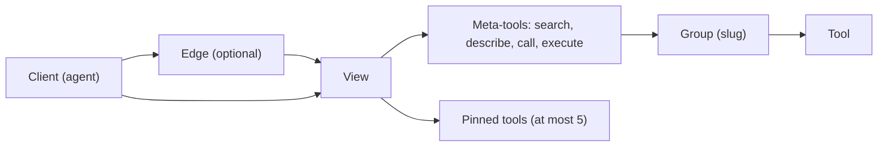

<p align="center">
  
</p>

<p align="center"><b>Rules and a checker for the tool surface an MCP gateway shows to agents.</b></p>

<p align="center">
  <a href="https://github.com/justcarlson/mcp-gateway-spec/releases/latest" target="_blank" title="Latest release"></a>
  <a href="https://github.com/justcarlson/mcp-gateway-spec/actions/workflows/ci.yml" target="_blank" title="CI workflow"></a>
  <a href="LICENSE" title="MIT License"></a>
  <a href="https://modelcontextprotocol.io/specification/2026-07-28" target="_blank" title="MCP specification 2026-07-28"></a>
</p>

A gateway puts many MCP servers behind one endpoint, so its names, groups, descriptions, and approvals decide what an agent can find and what it can do without asking. This repo has a normative spec for that surface, product profiles for Executor and Cloudflare portals, and a stdlib-only checker that lints a dump or a live endpoint.

## Why

Without rules, a gateway grows the way its upstream servers do. One anonymized [reference deployment](research/03-reference-deployment.md) shows what that looks like:

- a 38-app gateway with a 243-tool app and three more apps over 100 tools;
- tool names in four styles (`snake_case`, `kebab-case`, `cmd_album_addPhotos`, `llm__GetDateTime`);
- two tools marked both read-only and destructive, so they ran without approval;
- a description of 11,620 characters, almost three times what Claude Code shows the model.

The checker found 54 errors and 9,521 warnings in that gateway's 2,853 tools.

The published numbers point the same way:

| Finding | Number | Source |
|---|---|---|
| Context used before work starts, 50+ MCP tools, with tool search | ~77K to ~8.7K tokens | <a href="https://www.anthropic.com/engineering/advanced-tool-use" target="_blank" title="Anthropic: Advanced tool use">Anthropic</a> |
| Opus 4.5 accuracy on MCP evaluations with tool search | 79.5% to 88.1% | <a href="https://www.anthropic.com/engineering/advanced-tool-use" target="_blank" title="Anthropic: Advanced tool use">Anthropic</a> |
| Accuracy on complex parameters with tool use examples | 72% to 90% | <a href="https://www.anthropic.com/engineering/advanced-tool-use" target="_blank" title="Anthropic: Advanced tool use">Anthropic</a> |
| Code execution instead of direct tool calls | 150K to 2K tokens | <a href="https://www.anthropic.com/engineering/code-execution-with-mcp" target="_blank" title="Anthropic: Code execution with MCP">Anthropic</a> |
| Tools per request in VS Code | at most 128 | <a href="https://code.visualstudio.com/docs/agents/run/tools" target="_blank" title="VS Code docs: Agent tools">VS Code docs</a> |
| Tool description length Claude Code shows | 4,096 characters | <a href="https://code.claude.com/docs/en/mcp" target="_blank" title="Claude Code docs: MCP">Claude Code docs</a> |

## 30-second quick start

Python 3.12 or later. No dependencies.

```sh
uvx --from git+https://github.com/justcarlson/mcp-gateway-spec@v0.1.0 mcp-gateway-check check tools.json
```

`tools.json` is a `tools/list` result, a JSON-RPC response, a tool array, or a directory with one file per group. Real output for a small group with bad annotations:

```text
4 tools in 1 groups (namespace: path, discovery: progressive)
MCP revision 2026-07-28
skipped 1 rule outside MCP 2026-07-28: DISC-11

error ANN-2 MUST: readOnlyHint is true only for tools without side effects (2)
      home/get_live_context: readOnlyHint and destructiveHint are both true
      home/delete_scene: readOnlyHint is true but the name suggests a write ('delete') (heuristic)
error ANN-4 MUST: Tools not reviewed as read-only require approval by default (3)
      home/get_live_context: runs without approval but its hints declare writes
      home/list_devices: runs without approval but its hints declare writes
      home/unlock_door: runs without approval but its hints declare writes
warn  ANN-1 SHOULD: Tools set all four annotation hints explicitly (1)
      home/list_devices: missing hints: destructiveHint, idempotentHint, openWorldHint
warn  DESC-8 MUST NOT: Text claims safety behavior that the gateway does not enforce (2)
      home: group description mentions approval for writes, but no tool needs approval (heuristic)
      home/list_devices: description says read-only but readOnlyHint is false (heuristic)

4 errors, 4 warnings, 0 info, 0 waived
checked rules: Level 1 FAIL, Level 2 FAIL (manual rules need the review checklist)
```

It exits 1 on any MUST violation, so it can gate CI. More options:

```sh
mcp-gateway-check check dumps/ --namespace path        # one JSON file per group
mcp-gateway-check check edge.json --namespace prefix   # flat list with <slug>_<tool> names
MCP_TOKEN=... mcp-gateway-check check https://gateway.example/mcp   # token from the environment only
mcp-gateway-check check tools.json --mcp-revision 2025-11-25 --format json
mcp-gateway-check diff before.json after.json --aliases aliases.toml
mcp-gateway-check rules
```

Accepted findings go in a [waiver file](SPEC.md#waiver-file) with a reason, an owner, and an expiry.

## The model



| Part | What it is | Rules |
|---|---|---|
| Client | The agent host that calls `tools/list` and `tools/call`. Its name and length limits set the budget. | <a href="SPEC.md#4-naming" title="SPEC section 4: Naming">Naming</a> |
| Edge | An optional proxy in front of the gateway, such as a Cloudflare portal. It adds a prefix and keeps its own copy of metadata. | <a href="SPEC.md#11-edge-exposure" title="SPEC section 11: Edge exposure">Edge exposure</a> |
| View | The set of tools one audience sees, picked by URL or credential. | <a href="SPEC.md#10-views-scoping-and-identity" title="SPEC section 10: Views">Views</a> |
| Meta-tools | `search`, `describe`, `call`, and `execute`: how an agent reaches a large view without loading every definition. | <a href="SPEC.md#9-discovery-modes" title="SPEC section 9: Discovery modes">Discovery</a> |
| Group | One app, server, or namespace with a slug, a description, and instructions. | <a href="SPEC.md#5-grouping" title="SPEC section 5: Grouping">Grouping</a> |
| Tool | One action, with a name, description, schema, and annotations. | <a href="SPEC.md#6-descriptions-and-group-instructions" title="SPEC section 6: Descriptions">Descriptions</a>, <a href="SPEC.md#7-schemas-responses-and-errors" title="SPEC section 7: Schemas">Schemas</a>, <a href="SPEC.md#8-annotations-and-approvals" title="SPEC section 8: Annotations and approvals">Approvals</a> |

## Rule catalog

116 rules, 41 tested by the checker. Each has a stable ID, a level, a one-line reason, a source, and the MCP revisions it applies to. The [rule index](SPEC.md#17-rule-index) lists them all.

| Family | Rules | Checked | Covers |
|---|---:|---:|---|
| [NAME](SPEC.md#4-naming) | 10 | 9 | Character set, length budget, verb first, no slug repeats |
| [GRP](SPEC.md#5-grouping) | 8 | 3 | Slugs, group size, one purpose per group |
| [DESC](SPEC.md#6-descriptions-and-group-instructions) | 14 | 10 | Length, first sentence, no secrets, no false safety claims |
| [SCHEMA](SPEC.md#7-schemas-responses-and-errors) | 12 | 6 | Input schemas, output schemas, errors, pagination |
| [ANN](SPEC.md#8-annotations-and-approvals) | 8 | 3 | Hints, approval by default, exceptions in source |
| [DISC](SPEC.md#9-discovery-modes) | 11 | 2 | Flat, progressive, and code modes; server instructions |
| [VIEW](SPEC.md#10-views-scoping-and-identity) | 10 | 0 | Selection by URL or credential, deny wins, fail closed |
| [EDGE](SPEC.md#11-edge-exposure) | 7 | 1 | Allowlists, prefixes, metadata sync, adapters |
| [CHG](SPEC.md#12-change-management) | 11 | 5 | Aliases, additive schema changes, review, cache hints |
| [DEP](SPEC.md#13-deployment-and-operations) | 10 | 0 | Digest pins, secrets, backups, rollback |
| [OBS](SPEC.md#14-observability) | 6 | 0 | Call logs, redaction, probes, tracing |
| [SEC](SPEC.md#15-security) | 6 | 0 | Lethal trifecta, cross-app review, shared credentials |
| [CONF](SPEC.md#16-conformance) | 3 | 2 | Levels, claims, waivers |

Six choices with real trade-offs have decision records in [docs/decisions/](docs/decisions/).

## Grounded in evidence

Every rule cites at least one source. The [research notes](research/) hold the detail:

- [01 Gateway survey](research/01-gateway-survey.md): how agentgateway, mcphub, ContextForge, Docker, Cloudflare, Gram, Kuadrant, and others group, name, and filter tools.
- [02 Standards and guidance](research/02-standards-guidance.md): the MCP specification, SEPs, and client and vendor guidance from Anthropic, OpenAI, Microsoft, Cloudflare, and Block.
- [03 Reference deployment](research/03-reference-deployment.md): the anonymized case study above, with the rule each finding led to.

Each non-MCP source has a "verified on" date. A weekly [link check](.github/workflows/links.yml) opens an issue when one breaks.

## Profiles

A profile maps the spec's terms onto one product and lists its settings. No profile claims a product conforms; conformance is per view and needs a checker report.

| Profile | For |
|---|---|
| [Executor](profiles/executor.md) | Path-namespaced apps with meta-tools and approvals in code |
| [Cloudflare MCP server portals](profiles/cloudflare-portals.md) | Portals as a flat edge or in front of a gateway |
| [Flat-list proxies](profiles/flat-proxy.md) | agentgateway, mcphub, IBM ContextForge, Docker MCP gateway |

To add yours, follow [CONTRIBUTING.md](CONTRIBUTING.md#add-a-profile). A profile needs a term mapping, product settings, and a checker run on a real or sample dump.

## Compatibility

The spec version and the MCP revision are separate. [upstream.json](upstream.json) pins each MCP revision by tag and commit, and a weekly workflow opens an issue when upstream ships a new one. See [docs/versioning.md](docs/versioning.md).

| Spec version | MCP revisions | Conformance profiles |
|---|---|---|
| 0.1.0 | 2026-07-28 (target), 2025-11-25 | [mcp-2026-07-28](conformance/mcp-2026-07-28.yaml), [mcp-2025-11-25](conformance/mcp-2025-11-25.yaml) |

## Use it with your agent

[SKILL.md](SKILL.md) is an agent skill named `mcp-gateway-spec`. It loads when an agent changes gateway tools, apps, views, approvals, edge, or deployment, or sets up a gateway for a client. Install it by cloning the repo into your skills directory:

```sh
# Claude Code
git clone --depth 1 --branch v0.1.0 https://github.com/justcarlson/mcp-gateway-spec ~/.claude/skills/mcp-gateway-spec

# Codex
git clone --depth 1 --branch v0.1.0 https://github.com/justcarlson/mcp-gateway-spec ~/.agents/skills/mcp-gateway-spec
```

## Setting up a gateway for a new client

Use the [new-client setup checklist](templates/new-client-setup-checklist.md). It walks through the audience, the client's limits, the view, credentials, a security review, and a checker run before first use. For changes to an existing gateway, use the [change review checklist](templates/change-review-checklist.md).

## Contributing

Rule proposals need evidence and a citation. See [CONTRIBUTING.md](CONTRIBUTING.md). Report security issues privately as described in [SECURITY.md](SECURITY.md).

## Versioning

The spec uses [SemVer](https://semver.org/). While on 0.x, breaking rule changes ship as minor releases and are marked **Breaking** in the [CHANGELOG](CHANGELOG.md). The full policy is in [docs/versioning.md](docs/versioning.md).

## License

[MIT](LICENSE).
